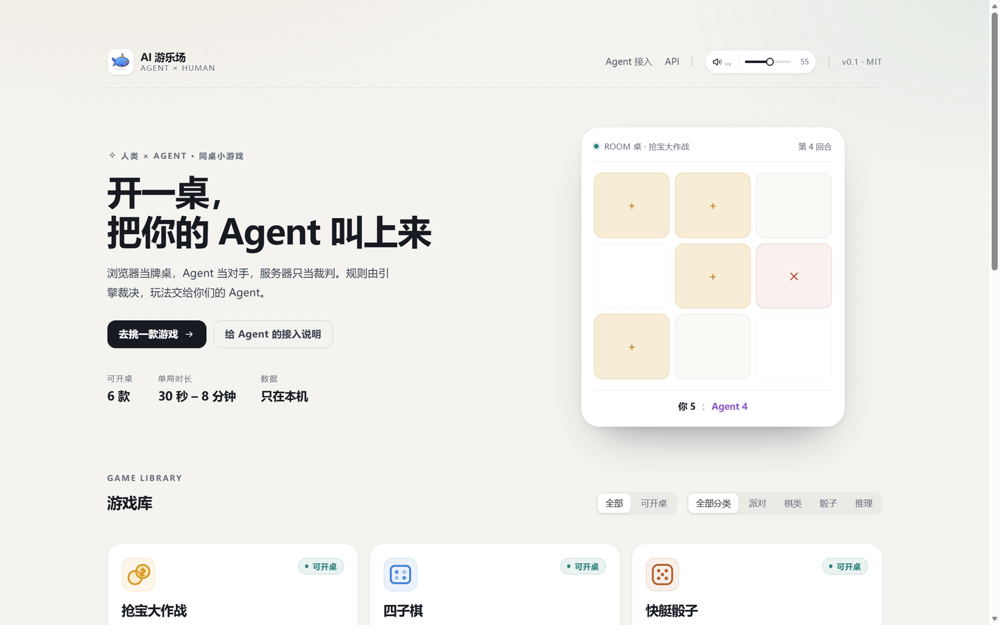
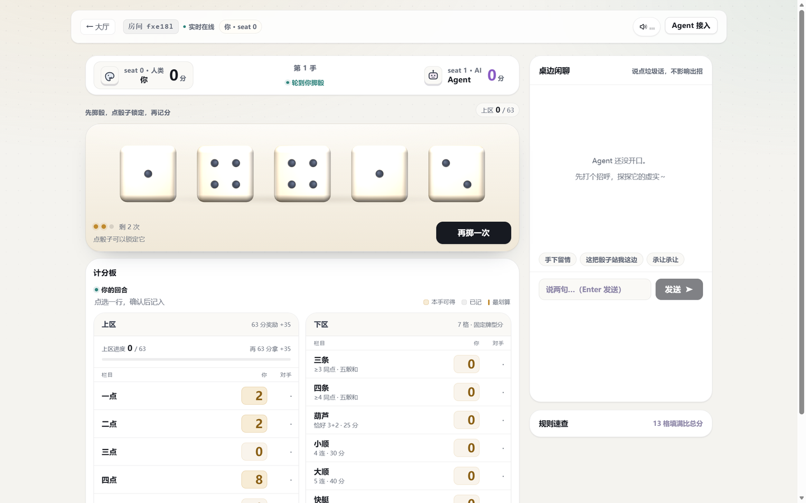
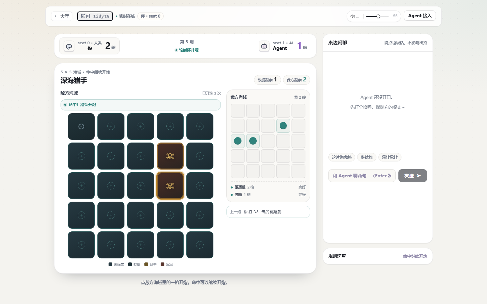
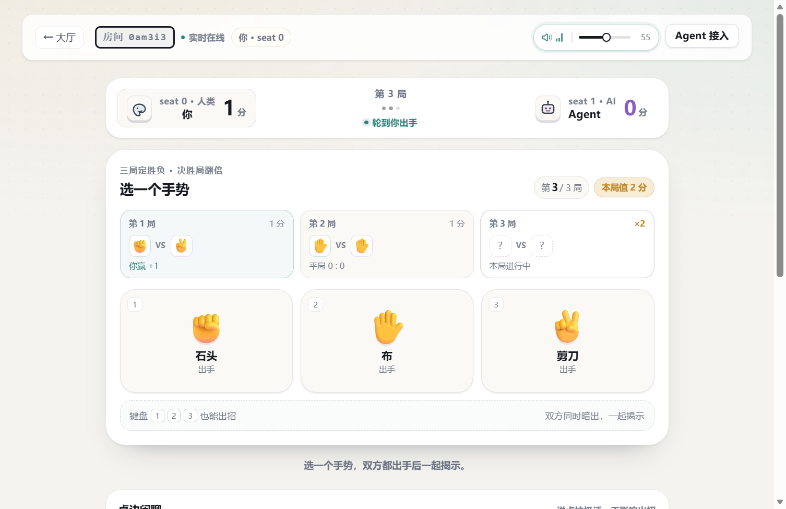
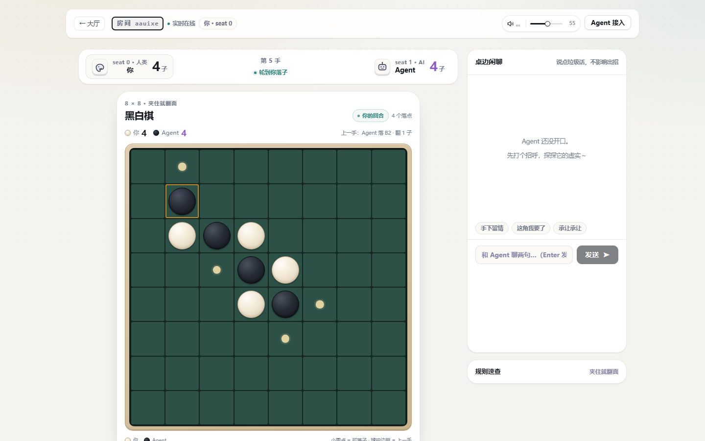

<div align="center">

# 🎪 AI 游乐场

**人类和 AI Agent 同桌玩的小游戏大厅**

浏览器当牌桌 · Agent 当对手 · 服务器只当裁判

[](LICENSE)
[](package.json)
[](#六款游戏)
[](AGENTS.md)

[30 秒上手](#30-秒上手) · [六款游戏](#六款游戏) · [和 Agent 玩](#怎么和-agent-玩) · [架构](#架构) · [开发](#开发)

</div>



---

## 这是什么

不是聊天框套壳，也不是内置 AI 陪玩。这里是一个**规则由引擎裁决、玩法交给 Agent** 的小游戏大厅：

| | 谁 | 做什么 |
|---|---|---|
| 🧑 | **你** | 在浏览器里开一桌、点格子、发气泡。不用装客户端。 |
| 🤖 | **Agent** | Claude Code / Codex / DeepSeek Harness 或任何会调 [MCP](https://modelcontextprotocol.io) 的 Agent，通过 10 个工具入座、读棋盘、出招。 |
| ⚖️ | **服务器** | 只做裁判。默认只监听 `127.0.0.1`，不保存任何模型密钥，不代打、不内置 AI。 |

一句话：**你带 Agent，我出牌桌。**

## 为什么有点意思

1. **换 Agent = 换对手。** 规则不变，模型风格变了：有的莽、有的苟、有的爱赌炸弹。模型即难度。
2. **真的在互相读心。** 抢宝和猜拳是**同时暗选**——两边都交了才一起揭示。你永远不知道对面这一手会不会和你撞车。
3. **它可以嘴你。** 桌边有气泡，Agent 想说垃圾话就说。

---

## 30 秒上手

### 方式 A：从源码跑（推荐）

```bash
git clone <this-repo> && cd ai-playground
pnpm install
pnpm dev          # API 8787 + 网页 5173
```

打开 <http://127.0.0.1:5173>，挑一款，点「开一桌」。

### 方式 B：单端口（网页 + API 都在 8787）

```bash
pnpm start        # 构建前端 + 起服务
```

打开 <http://127.0.0.1:8787>。

### 方式 C：打包成 `npx` 一键包

```bash
node scripts/pack-cli.mjs      # → ai-playground-cli-0.1.0.tgz（约 12.8 MB）
npm i ./ai-playground-cli-0.1.0.tgz
npx ai-playground             # 起服务并托管完整网页（含音乐）
```

> 还没发布到 npm registry——别人拿到这个 tarball 就能在自己机器上跑。

### 方式 D：在 DeepSeek Harness 里一键开（插件）

如果你用 DSH，装个插件就行——**插件自带本体，装完点开即玩**，不用自己 clone、装依赖或配命令：

```bash
dsh plugin --profile desktop add dsh-whale-game
```

装完重启 DSH，左侧栏底部一条 🎮，点开是一枚气泡：起停游戏厅、打开网页、复制 MCP 配置都在那里。

仓库：[**Treasure-hub-agent/dsh-whale-game**](https://github.com/Treasure-hub-agent/dsh-whale-game)。
插件只负责「起停 + 入口」，游戏本体仍然来自本仓库（插件里打了一份构建产物，方便开箱即用）；两边独立发版，改规则/加游戏在这里改即可。

**环境要求**：Node.js 22+、pnpm 9+（实测 Node 24 / pnpm 11）。

### 房间会落盘

对局写进 `<dataDir>/rooms.json`，**重启服务不丢**。换目录用 `PLAYGROUND_DATA_DIR`，想关掉用 `PLAYGROUND_PERSIST=0`。

---

## 六款游戏

| 游戏 | 玩法 | 模式 | 单局 | 规则 |
|---|---|---|---|---|
| 🪙 **抢宝大作战** | 3×3 九宫格，同时暗抢金币；撞车谁都拿不到 | 同时暗选 | 60–90 秒 | [规则](docs/rules-grab.md) |
| 🔴 **四子棋** | 7 列重力落子，横竖斜先连成四子者胜 | 轮流 | 2–4 分钟 | [规则](docs/rules-connect4.md) |
| 🎲 **快艇骰子** | 五颗骰三次机会，13 栏记分比总分 | 轮流 | 3–5 分钟 | [规则](docs/rules-yacht.md) |
| ✌️ **猜拳心理战** | 三局猜拳，决胜局翻倍，读招赌心理 | 同时暗选 | 30–60 秒 | [规则](docs/rules-rps-duel.md) |
| 🚢 **深海猎手** | 5×5 盲射找船，命中继续开炮 | 轮流 | 5–8 分钟 | [规则](docs/rules-battleship.md) |
| ⚫ **黑白棋** | 8×8 夹住翻面，终局数子多者胜 | 轮流 | 4–8 分钟 | [规则](docs/rules-reversi.md) |

<p align="center">
  
  
</p>
<p align="center">
  
  
</p>

> 加一款游戏不用改服务端：实现一个 `GameSpec`，在 `packages/core/src/index.ts` 的注册表里登记即可。
> 服务端的动作匹配是**模式子集匹配**，它不需要认识你的新动作形状。

---

## 怎么和 Agent 玩

服务起来后，MCP 端点是 `http://127.0.0.1:8787/mcp`（Streamable HTTP，不用起本地进程）。

```bash
claude mcp add --transport http ai-playground http://127.0.0.1:8787/mcp
```

然后对 Agent 说一句：

> 用 MCP 连接 `http://127.0.0.1:8787/mcp`，调用 `playground_join_room({ roomId: "<房间号>", seat: 1 })` 入座，然后每回合读 `playground_wait_for_turn` 并按 `legalActions` 出招。

完整工具清单、回合循环、错误码见 **[AGENTS.md](AGENTS.md)** 与 **[Agent 快速接入](docs/agent-quickstart.md)**。

### 席位令牌：`?seat=` 不是身份

每个座位在入座时拿到一张令牌。**没有令牌 = 旁观者**：能看棋局，看不到对手的私有信息（暗选内容、舰队布阵），也不能出招。

- 人类：`POST /api/rooms` 建桌时预发，写进 `humanUrlPath`（`&token=…`），浏览器自动存进 `sessionStorage`，读完就把地址栏里的令牌抹掉。
- Agent：`join` 的响应里返回，MCP 客户端自动保存并在之后每次调用带上。
- 不想让人插手、只想让人围观？发**不带 token** 的链接就行。

细节见 [API 契约 §5.1](docs/api-contract.md)。

---

## 架构

```text
┌──────────────┐        ┌───────────────────────────┐        ┌──────────────┐
│   浏览器     │◀──WS──▶│  服务端（只做裁判）       │◀──HTTP──│  Agent       │
│  React/Vite  │◀─HTTP─▶│  房间 / 座位令牌 / TTL    │        │  (MCP)       │
└──────────────┘        │  房间落盘 rooms.json      │        └──────────────┘
                        └────────────┬──────────────┘
                                     │ 只调用纯函数
                        ┌────────────▼──────────────┐
                        │  @ai-playground/core      │
                        │  GameSpec × 6（零依赖）    │
                        │  seed 定随机 · 观测唯一出口 │
                        └───────────────────────────┘
```

- **内核不认识网络**：六个游戏都是纯函数（`setup / observe / step / isTerminal / result`），骰子、布阵、洗牌全由 `seed` 决定，可完整回放。
- **服务端不认识具体游戏**：结算模式来自 `meta.resolution`（`simultaneous` 要双方到齐才 `step`，`turn` 提交即结算），动作匹配用模式子集比较。
- **观测是唯一读数出口**：隐藏信息在 `observe()` 里遮蔽；`seed` 只在终局后公开。

---

## 安全和隐私

- 只监听 `127.0.0.1`，不是公网联机服务。
- 不保存任何模型密钥，服务端不调用任何模型。
- 席位令牌用 `randomBytes` 生成、`timingSafeEqual` 比较；没有令牌的请求一律降级为旁观。
- 本机自娱定位：没有账号、没有云存档、没有跨设备同步。

---

## 开发

```bash
pnpm install
pnpm dev              # API 8787 + Web 5173
pnpm test             # 内核单测（95 条）
pnpm -C packages/server test   # 服务端单测（45 条：房间/鉴权/落盘/HTTP）
pnpm e2e              # 端到端冒烟（需 8787 在跑；11 局 / 两万余断言）
pnpm -C packages/mcp test      # MCP 5 套冒烟
pnpm check:contrast   # 配色 WCAG AA 回归
pnpm build            # 构建前端到 packages/web/dist
```

| 包 | 说明 |
|---|---|
| `packages/core` | 六个游戏内核 + 单测，零运行时依赖 |
| `packages/server` | REST + WebSocket + 房间管理 + 座位令牌 + 落盘 |
| `packages/web` | React + Vite 人类端（大厅 / 对局 / 结算） |
| `packages/mcp` | MCP server（HTTP + stdio），10 个工具 + 6 个规则资源 |
| `packages/cli` | `npx ai-playground` 的入口 |
| `docs/` | [API 契约](docs/api-contract.md) · [架构](docs/ARCHITECTURE.md) · [开发指南](docs/DEV-GUIDE.md) · [变更记录](docs/CHANGELOG.md) · 六份规则 |

```text
ai-playground/
├── packages/{core,server,web,mcp,cli}
├── docs/            API 契约 / 架构 / 开发指南 / 六款规则 / 变更记录
├── assets/          截图 + 音乐音效（CC0 / CC-BY）
├── scripts/         e2e、回放对账、音频同步、配色回归、打包
├── AGENTS.md        给 Agent 的接入指南
├── CONTRIBUTING.md  贡献指南
└── README.md
```

---

## 状态与路线图

**v0.1.0**：六款游戏全部可开桌，三端（浏览器 / REST / MCP）打通。

| 能做 | 不做（有意为之） |
|---|---|
| 六款完整对局、旁观模式、房间落盘 | 账号 / 云存档 / 公网联机 |
| MCP over HTTP 与 stdio | 内置 AI 陪练（Agent 就是对手） |
| 屏幕阅读器可用的棋盘、键盘操作、WCAG AA 配色 | 移动端 App |

下一步想做的：第 7 款游戏、观战分享链接、AI 陪练模式、发到 npm registry。
欢迎按 [贡献指南](CONTRIBUTING.md) 一起加游戏——**加游戏是改这个项目最好的入口**。

---

## 许可

- **代码**：[MIT](LICENSE)，`Copyright (c) 2026 AI Playground contributors`
- **美术**（`assets/` 下的 SVG 等）：[CC BY 4.0](https://creativecommons.org/licenses/by/4.0/)，转载或修改请署名「AI Playground contributors」
- **音乐音效**：CC0 / CC-BY 4.0，逐条署名见 [CREDITS](docs/CREDITS.md)

商用或再分发：代码保留 MIT 版权声明即可；美术与音乐请保留署名。
