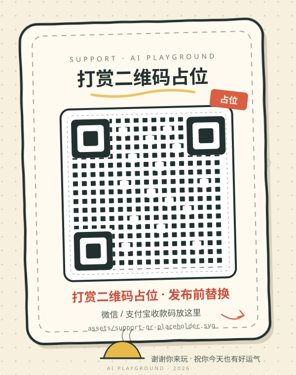

# 支持《AI 游乐场》

如果这个游乐场让你和 Agent 多笑了几次，可以请作者喝杯奶茶。**完全自愿，不影响任何功能，也不解锁任何东西。**

当前仓库里只有占位图，**没有接任何支付、没有真实收款码**。

## 打赏页文案（可直接用）

> **请作者喝杯奶茶**
>
> 《AI 游乐场》是一个开源的小项目：没有账号、没有云服务、没有内置 AI，服务器只在你自己的电脑上跑。
>
> 如果它让你和 Agent 多玩了几局，可以扫码请作者喝杯奶茶。你的支持会用来买奶茶、交电费，以及继续加新游戏。
>
> 打赏完全自愿，不影响功能，也不提供任何特殊权限。谢谢你来玩。

（发布前请把上面这段和占位图一起检查一遍，按实际渠道调整。）

## 占位图怎么替换

**发布前**把本页和 README 里的占位图换成真实收款二维码：

1. 从微信 / 支付宝导出个人收款码，建议 PNG 或 SVG，**不小于 600×600**，保证手机能扫。
2. 把二维码存为 `assets/support-qr.png`（或 `.svg`），然后修改：
   - 本文件的 ``
   - `README.md` 里「打赏」一节的 ``
   如果导出的是同尺寸 SVG，也可以直接同名覆盖 `assets/support-qr-placeholder.svg`，这样两处路径都不用改。
3. 用手机实际扫一遍（微信、支付宝各一次），确认能打开正确的收款页。
4. 提交前再确认：图里没有夹带手机号、真实姓名、订单号等不想公开的信息。

> 注意：真实收款码一旦进入公开仓库，就会被 fork / 缓存 / 搜索引擎收录，**基本无法撤回**。只放你愿意公开的那一张。

## 打赏的边界

- 不接支付 API，不做订单、退款、发票、会员、解锁内容。
- 不收集任何打赏者信息。
- 打赏不是购买服务，也不构成任何服务承诺。
- 如果以后加了 `web` 的 `/support` 路由，记得把本页文案和占位图同步过去。

## 许可

- 代码：[MIT](../LICENSE)
- 美术（`assets/` 下的 SVG 等）：[CC BY 4.0](https://creativecommons.org/licenses/by/4.0/)
